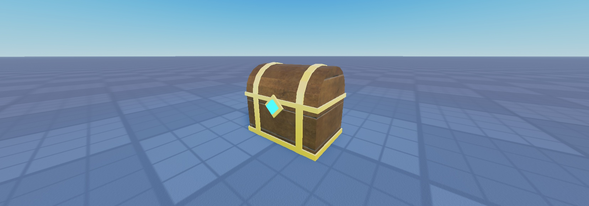

# Roblox AI Asset Pipeline

Turn a text prompt into a finished, game-ready 3D model in Roblox Studio.



The pipeline has four stages:

1. **`flux.py`** generates a concept image with FLUX on Cloudflare Workers AI.
2. **`export_asset.py`** runs inside Blender. It checks the triangle budget and exports a game-ready FBX.
3. **`upload.py`** uploads the FBX with the Roblox Open Cloud Assets API and polls until it gets an asset ID.
4. **`finish_asset.lua`** runs in Studio. It inserts the asset, then sets colors, materials and lights and puts it on the ground.

Full write-up: **[article link]**

## Requirements

- Python 3.10+ and `pip install -r requirements.txt`
- Blender and Roblox Studio
- A Cloudflare account with a Workers AI API token
- A Roblox Open Cloud API key with Assets read/write permission, and your IP on the key's allowed list

## Setup

Set these as **user environment variables**. Never put them in code:

| Variable | What it holds |
| --- | --- |
| `CLOUDFLARE_ACCOUNT_ID` | Your Cloudflare account ID |
| `CLOUDFLARE_API_TOKEN` | A Workers AI API token |
| `ROBLOX_API_KEY` | Your Open Cloud API key |
| `ROBLOX_CREATOR_ID` | Your Roblox user ID |

Restart your terminal and Blender after setting them.

## Usage

```bash
# 1. Concept image
python flux.py "wooden treasure chest with gold bands" --out TreasureChest.jpg

# 2. Model in Blender to match (parts named TreasureChest_Wood, TreasureChest_Metal, ...),
#    then run export_asset.py in Blender's Scripting tab.

# 3. Upload
python upload.py TreasureChest.fbx --description "Low-poly treasure chest"

# 4. Paste the asset ID into finish_asset.lua and run it in Studio's command bar.
```

## Troubleshooting

| Error | Fix |
| --- | --- |
| `Missing environment variable` | Set the variable, then restart the terminal or Blender |
| 401 Invalid API Key | Check your current IP is on the key's allowed list, or regenerate the key |
| 403 Forbidden | Give the key Assets read and write permission |
| Model imports 100x too big | Keep `global_scale=0.01` in the FBX export |
